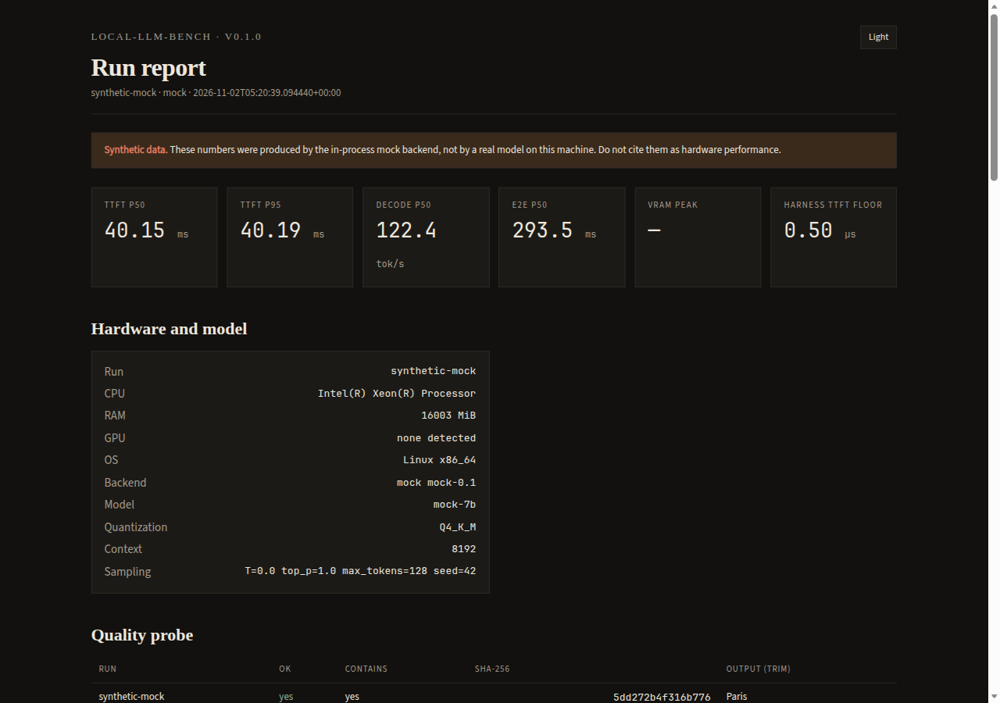

# local-llm-bench

**Measure local LLM inference on the machine in front of you** — time to first token, decode throughput, prefill rate, tail latency, concurrency, and memory — without sending prompts to a paid API.

Built by [Lucas Guerra](https://github.com/NotSkittlz) (UC Berkeley, physics). v0.1 is a tool you can run today: typed Python, a small adapter interface, a mock backend for tests, and a self-contained HTML report.



The screenshot is **synthetic**. It was generated with `--backend mock` on whatever CPU produced this commit. Those bars are not GPU performance. Do not quote them as hardware numbers.

## Why this exists

If you serve a model on your own box you eventually ask: *how many tokens per second, how long until the first one, how much VRAM, and did I just break quality by chasing speed?* Vendor slides will not answer that for *your* quantization, context, and server flags. local-llm-bench records those settings next to the numbers, measures the harness so the client is not silently in the result, and refuses cloud endpoints.

## Quickstart

Python 3.11+.

```bash
pip install -e ".[dev]"
# or: uv pip install -e ".[dev]"

# Demo — no GPU, no model (synthetic ~40 ms TTFT / ~8 ms per token)
llmbench run --backend mock --label demo
# writes results/run.json, .csv, .html

# Real local server (Ollama example)
llmbench run --backend ollama --model llama3.2 --base-url http://127.0.0.1:11434

# llama.cpp server / vLLM / any OpenAI-compatible loopback URL
llmbench run --backend llamacpp --base-url http://127.0.0.1:8080 --model qwen2.5-7b
llmbench run --backend vllm --base-url http://127.0.0.1:8000 --model qwen2.5-7b

llmbench report results/run.json -o results/report.html
llmbench compare run-a.json run-b.json --html compare.html
llmbench overhead    # client floor vs zero-delay mock
llmbench hardware    # what we could detect
```

YAML config (see `examples/llmbench.yaml`):

```bash
llmbench run -c examples/llmbench.yaml
```

## What you get

| Command | Output |
| --- | --- |
| `run` | JSON (canonical), CSV (one row per trial), HTML report |
| `report` | Self-contained HTML (dark/light, SVG charts, no CDN) |
| `compare` | Markdown tables for READMEs + optional HTML overlay |

JSON schema version **1.0.0** — see [docs/schema.md](docs/schema.md).

## Metrics

| Metric | Definition (short) |
| --- | --- |
| TTFT | Client time to first generated token of any kind (`perf_counter_ns`); `ttft_content_ms` is time to first *content* token |
| Decode tok/s | Server `eval_count/eval_duration` or `predicted_n/predicted_ms` when present; else `(output_tokens − 1) / (last − first)` over the full generated span |
| Prefill tok/s | Uncached prompt tokens / uncached prompt ms (null if unknown; omitted for prompts under 256 tokens). Proxy `prompt_tokens / TTFT` is stored separately and never mixed in |
| E2E p50 / p95 | End-to-end latency over successful measured trials |
| Concurrency | Open-loop in-flight `C`; wall tok/s **and** per-request latency |
| Memory | GPU VRAM via NVML / `nvidia-smi` (1 Hz fallback), Apple/AMD best-effort, process RSS |
| Harness floor | Zero-delay mock TTFT, recorded on every run |
| Quality probe | Separate greedy request with `thinking=off`; SHA-256 + optional substring on content only; does not rewrite speed-run sampling |

Defaults: `seed=42`, `warmup=2`, `iterations=16`, `concurrency=[1]`, greedy sampling (`T=0`). Warmup is a distinct prefix of the prompt sequence and is **excluded** from percentiles. `--thinking {default,off,low,medium,high,xhigh}` is recorded on the snapshot. `--quality-strict` aborts if the greedy probe fails.

Speculative decoding (Ollama draft models / `draft_num_predict`) makes decode tok/s **prompt-dependent**: accepted draft tokens vary with content, so the same model can show different decode rates on different suites. Compare like-for-like prompts.

llama.cpp keeps a RAM prompt cache. When it evicts an entry ("making room for prompt cache entry"), a later prompt of similar length can re-prefill in seconds instead of a cache-hit millisecond path. The harness notes this when prefill-time p90/p50 is large; it does not drop trials.

The long version — clocks, token-count sources, thermal throttling, batching, queueing vs compute — is [docs/methodology.md](docs/methodology.md). Read it before you paste a table into a README.

## Supported backends

Local HTTP only. Hosts are resolved and every address is checked (loopback, RFC1918, IPv6 ULA). Link-local and cloud metadata (`169.254.169.254`, `fd00:ec2::254`, `metadata.google.internal`) are refused. Public IPs and prefix-trick hostnames like `10.attacker.com` are refused unless you pass `--allow-remote`.

| `backend.type` | How we talk to it | Default URL |
| --- | --- | --- |
| `mock` | In-process, no network | — |
| `llamacpp` | OpenAI-compatible `/v1/chat/completions` (stream) | `http://127.0.0.1:8080` |
| `vllm` | Same protocol | `http://127.0.0.1:8000` |
| `openai_compat` | Same protocol, any local URL | `http://127.0.0.1:8080` |
| `ollama` | `/api/chat` NDJSON stream | `http://127.0.0.1:11434` |

The harness never changes temperature, top_p, max tokens, or stop sequences to make a speed run look better. Parameter names are mapped per backend (vLLM `repetition_penalty`, Ollama `num_ctx` / `min_p` / `stop`); anything not sent is listed in `sampling.dropped`. `--quantization` and `--context-length` are user-declared metadata except Ollama `num_ctx`. Quality checks are a second request with greedy settings, recorded under `quality`.

## Sample data

`samples/` is a **mock** run with configured 40 ms TTFT and 8 ms/token delays plus this machine's real CPU/RAM metadata.

- `samples/synthetic-mock-results.json` — schema 1.0.0, `"synthetic": true`
- `samples/synthetic-mock-report.html` — open in a browser
- `samples/synthetic-mock-tables.md` — markdown excerpt

Regenerate with `llmbench run -c examples/synthetic-mock.yaml`.

## Development

```bash
pip install -e ".[dev]"
ruff check src tests
ruff format src tests
pytest
```

CI: GitHub Actions on `ubuntu-latest`, Python 3.11, 3.12, and 3.13, ruff + pytest. See [CONTRIBUTING.md](CONTRIBUTING.md).

## Roadmap

- Energy (joules) when a vendor counter exists
- Optional inter-token latency histogram (flag exists; off by default)
- Server-process discovery by listen port (today: pass `backend.pid` for RSS)
- Windows GPU probes beyond NVML
- Embeddings / vision later, not in v0.1

## License

MIT. Copyright 2026 Lucas Guerra.
